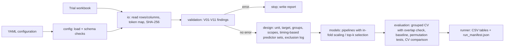

# Architecture

| Component | Responsibility | Key functions |
|---|---|---|
| `config` | parse YAML, enforce schema, hash the configuration | `load_config`, `Config.sha256` |
| `io` | read the workbook range, keep raw values, convert with an explicit token map, report bad cells | `read_plot_table`, `to_numeric`, `file_sha256` |
| `validation` | rule-based checks returning `Finding(check, severity, variable, message)` | `validate`, `check_relations`, `replicate_profile`, `check_reference` |
| `design` | treatment means, scopes, dummies, timing cut-offs, deterministic column order, exclusion log | `treatment_means`, `build`, `eligible_predictors`, `exclusion_log` |
| `models` | model registry; every model is a scikit-learn Pipeline; in-fold `TopKSpearman` selector | `make_model`, `TopKSpearman` |
| `evaluation` | grouped predictions with group-overlap check, metrics, permutation tests | `grouped_predictions`, `y_permutation`, `block_permutation` |
| `runner` | orchestrates a run and writes outputs and the manifest | `run`, `load_and_validate`, `anova_means` |

Design decisions
- Validation never changes data. Unconvertible cells become missing and are reported; decisions about
  variables are made in the configuration, where each exclusion needs a written reason.
- The unit of analysis is part of the configuration. Treatment means are the default for trials whose
  replicates cannot be shown to be independent.
- Predictor sets are defined by measurement timing, so a variable measured after the prediction date can
  never enter a set.
- Column order inside a set is fixed by rule (earlier cut-off first, then configuration order), because
  random forests with `max_features < 1` give different results for different column orders.
